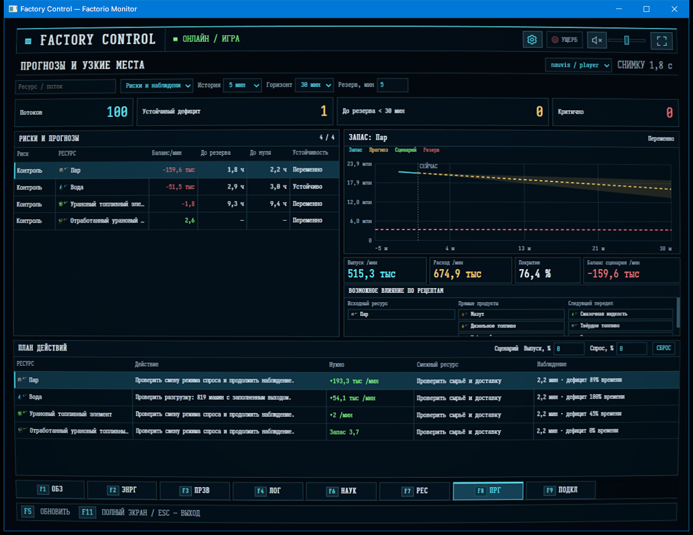

# Factory Control

A desktop control room for **Factorio on Windows x64**. Monitor production, power, logistics, research, resources and attacks on a second screen. Runs locally without an AI model or cloud service.

[Download published releases](https://github.com/noteMASTER11/Factory-Control/releases) · [Telemetry mod](mod/factory-telemetry/README.md) · [Third-party notices](THIRD_PARTY_NOTICES.md)



## Current release

**[Factory Control 0.10.7](https://github.com/noteMASTER11/Factory-Control/releases/tag/v0.10.7)** includes Factory Telemetry **0.10.7**. Choose the complete download for **Factorio 2.0** or **Factorio 2.1 experimental**. Both include the desktop EXE, matching mod and installer.

## Requirements and installation

- Windows x64 and Microsoft Edge WebView2 Runtime. The desktop executable bundles .NET.
- Factorio purchased separately. Collector packages target **2.0.77+** or **2.1.23+ experimental**; use the archive matching the game's branch. Quality and Space Age are optional dependencies.
- PowerShell 7 to run the installer.

To install:

1. Download and extract `FactoryControl-0.10.7-Factorio-2.0.zip` or `FactoryControl-0.10.7-Factorio-2.1.zip` from the release. Keep `FactoryControl.exe`, the included mod ZIP and `Install-FactoryControl.ps1` together. Do not extract the mod ZIP.
2. Close Factorio completely and run the installer, replacing `<Factorio>` with your game installation folder:

   ```powershell
   pwsh -File ./Install-FactoryControl.ps1 -GameExecutable '<Factorio>/bin/x64/factorio.exe'
   ```

   The default installation folder is `%LOCALAPPDATA%\FactoryControl`. Use `-InstallDirectory '<destination>'` to choose another folder and `-GameProfile '<profile>'` for a nonstandard Factorio profile.

3. Start Factorio, load a save with **Factory Telemetry Bridge** enabled, then open `Factory Control.cmd` from the installation folder and select the detected session.

The installer enables the mod in the selected profile and connects its `script-output` to the application's data folder. It stops if an existing nonempty output folder or conflicting link needs attention. Existing saves are not copied or replaced. Updating Lua code requires reloading the map; mod activation requires a game restart.

If installed files are present but the mod is disabled, enable it through Factorio's **Mods** menu and keep it enabled when synchronizing a save's mod set. Editing `mod-list.json` while Factorio is running does not activate a mod: the game can overwrite those edits on exit. Connection diagnostics distinguish a disabled mod, a pending restart, an unloaded map and an export that has not arrived yet.

Application data, history, logs and profiles are kept in the configured data root. The installer creates a `Data` folder in the chosen installation; direct launches accept `--data-root=<folder>`.

## Features

| View | What it shows |
|---|---|
| Overview | Persistent spatial machine issues, grouped nearby machines, measured locations, native map navigation, production history and conditional advice. Global deficits have no invented coordinates. |
| Power | Networks, generation and demand, sources and consumers, theoretical capacity, accumulator charge and history. |
| Production | Item/fluid flows, balance, monitored stock, recipes, idle states, demand coverage, conditional depletion, search and observed UPS. Table and native map views; Space Age imports/exports in material details. |
| Logistics | Robot networks, requests, deliveries, shortages, trains and cargo. Space Age tables and an interactive transport map with platforms, cargo pods, loading, cargo/quality filters and observed leg ETA. |
| Research | Current technology and level, progress, queue, science-pack flows, laboratory states and conditional ETA. |
| Resources | Surveyed resource chunks, deposit groups, remaining amounts, observed depletion and conditional exhaustion estimates. |
| Forecasts | Persistent deficits, reserve/zero-stock horizons, recipe relationships and production/demand scenarios. |
| Connection | Detected Factorio processes, session selection, channel state, data age and collection coverage. |
| Damage | Attacks, destroyed/rebuilt structures, outstanding rebuilding costs and comparison with monitored stock. |

- **11 languages:** English, German, Spanish, French, Czech, Hungarian, Estonian, Finnish, Portuguese, Russian and Ukrainian. First launch suggests the Windows interface language with English fallback; the choice remains available in settings. UI strings use JSON locale files.
- Resizable layout including 1024×768 and 1152×864, mixed-DPI support, fullscreen on the current monitor and 70–175% UI scale.
- Optional CRT effects, adjustable audio, ASCII startup and screen transitions. Attack alerts include a temporary red theme and an alarm that ends with the attack.
- UI and effects share a **30 FPS** cap. Background workers maintain history/models; hidden views stop rendering and native map requests.
- Native map imagery fills progressively and retains loaded imagery while panning or refreshing. Unknown or uncollected areas remain empty.
- Optional diagnostic logs, disabled by default, with a settings shortcut to their folder.

**Shortcuts:** F1 overview · F2 power · F3 production · F4 logistics · F5 refresh · F6 research · F7 resources · F8 forecasts · F9 connection · F10 settings · F11 fullscreen · Esc leave fullscreen/settings.

## Telemetry and limits

[Factory Telemetry Bridge](mod/factory-telemetry/README.md) adds no prototypes or gameplay changes. It exports completed snapshots to `script-output/factory-telemetry/` across eight channels: `status`, `production`, `machines`, `power`, `logistics`, `research`, `resources` and `combat`. Space transport observations are included in logistics; native map pixels are exported separately.

Collection is incremental: up to 16 indexed entities per tick, paged requester data, bounded transport observation and one native chart read per six ticks. Snapshots report session, tick, coverage and collection errors. Large worlds need time for initial discovery; rolling samples are not simultaneous measurements of the entire factory. Opening a view or calling an API reads prepared data and never triggers a new game scan.

- Monitored stock excludes belts, inserter hands, pipes, players and fuel inventories. Stock in a container does not imply that every consumer can reach it.
- Production-flow item totals currently use normal quality. Inventory and transport observations retain quality where available.
- Generator ratings are theoretical capacity; accumulator charge is not assigned to individual networks.
- Forecasts are conditional on observed history and coverage. They do not promise exact machine counts or train arrival times. Infinite resource patches have no finite exhaustion estimate.
- Map coverage follows factories, players and observed/charted areas under collection limits; it is not an unrestricted world scan or a complete rail/sprite renderer.
- In multiplayer, exports are written by the server. The desktop application needs access to those files.

The embedded Bridge/Gateway shares prepared snapshots with the desktop. SQLite history is separated by session, retains 60 minutes by default and compresses new snapshots without loss. The local interfaces are:

| Interface | Address / operations |
|---|---|
| MCP | `http://127.0.0.1:18740/mcp` — `telemetry_snapshot`, `telemetry_capabilities` |
| HTTP | `http://127.0.0.1:18741/api/v1/` — status, sessions, overview, `telemetry/{topic}`, forecasts, history, client updates and SSE events |
| Native map | HTTP map manifest, tiles and composed pages from completed exports of the current session |

## Source and build

- `src/`: .NET 10, WPF/WebView2 desktop, Bridge/Gateway, telemetry models and SQLite history.
- `mod/factory-telemetry/`: Lua collector.
- `tests/`: .NET, collector/model and browser checks.
- `docs/evidence/`: application captures and validation evidence.

Use the SDK version in `global.json` and PowerShell 7. The repository build scripts use the development environment configured in `scripts/env.ps1`.

```powershell
pwsh -File ./scripts/build.ps1 -Publish
pwsh -File ./scripts/package-telemetry.ps1 -GameBranch 2.0
pwsh -File ./scripts/package-telemetry.ps1 -GameBranch 2.1
```

The application is written to `dist/FactoryControl.exe`; collector archives go to `dist/mods/2.0/` and `dist/mods/2.1/`. Game names/icons are prepared during development, not imported on normal startup.

Factorio artwork and translations belong to Wube Software. This project is not officially affiliated with Wube Software. Included font/library licenses and other attributions are listed in [third-party notices](THIRD_PARTY_NOTICES.md).
